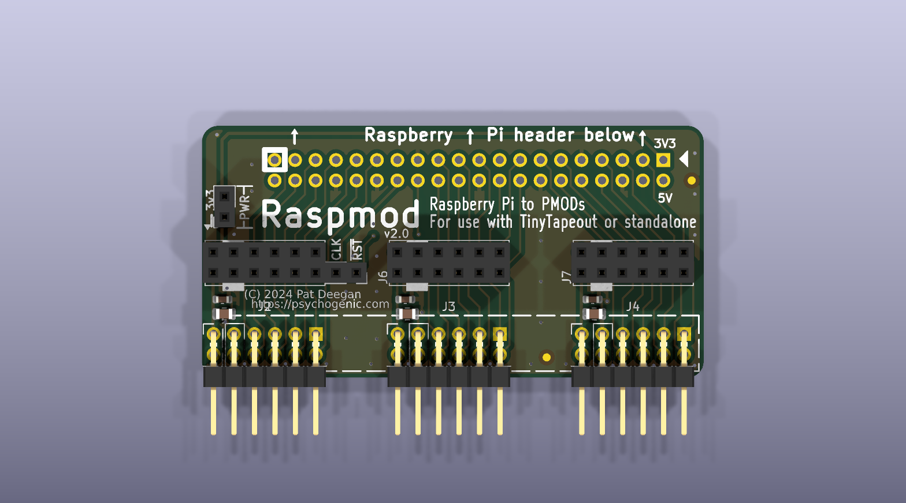
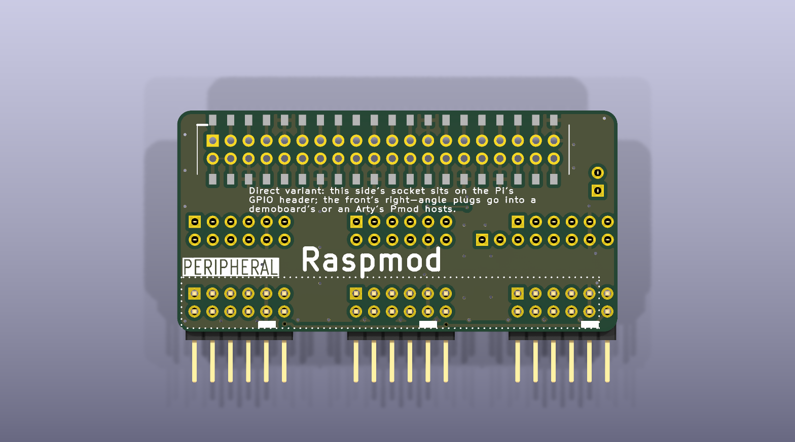
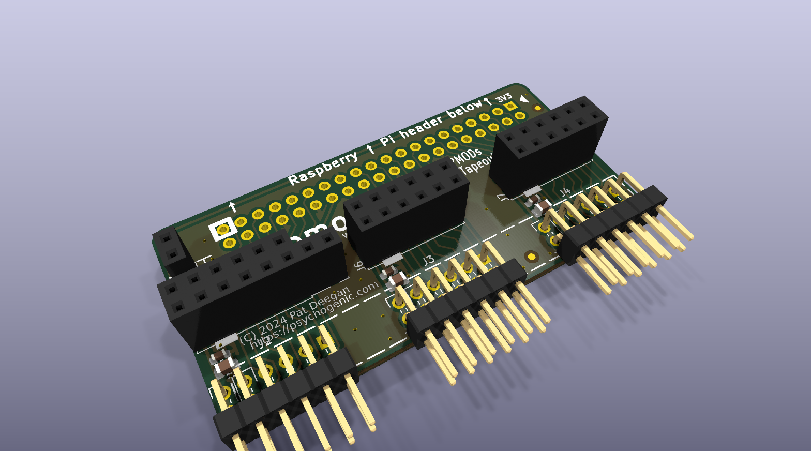

# Raspmod: TinyTapeout demoboard to Raspberry Pi

Connects all I/O from TT demoboard to RPi ribbon cable while still allowing the PMODs to be used with external modules.


Simple two layer board, everything but the 100 mil headers is pretty much optional.

Only annoying bit is that the clock and reset are only available through the SIL (not one of the PMODs) so these must be connected by adding a 2-pin header to the demoboard in the right spot.

 


## Direct variant: on the Pi's GPIO header, flat beside the FPGA board

This branch (`direct-gpio`) is the same board altered to do without the
ribbon. It sits **on** a Raspberry Pi's 40-pin header, and lies flat beside
a Tiny Tapeout demoboard or a Digilent Arty, plugging into their Pmod
hosts sideways.





What changed, and why:

- **J1** is a low-profile SMT socket on the underside -- Adafruit 2187,
  Kaweei CS25582-40G-M36-0A, 3.8 mm tall -- so the board sits straight on
  the Pi's header. The socket's own drawing has the pins pass through the
  PCB, so the forty plated holes stay as they were and forty SMT pads join
  them, each linked to its hole on the back. The pads are the middle 1.5 mm
  of the 2.1 mm the drawing shows: the full pad would stop 0.33 mm from the
  board edge, and the ground pour needs the room between the holes and the
  pads.
- **J2, J3, J4**, the straight plugs on the underside that went into a
  demoboard's hosts while the board stood on edge, are right-angle 2x6
  headers on the component side, pins out past the edge (Wurth 61301221021
  or the like). Same pads, same numbers, same nets; the footprint is the
  Tiny Tapeout library's right-angle one mirrored, since the library's
  numbering would put pin 1 at the other end.
- **10 mm shorter** at the pin-40 end. Sat on the Pi, that end reached
  over the Pi's Ethernet or USB stack, 13.5 to 16 mm tall, which a board
  6.3 mm up cannot clear. J10 (the auxiliary socket) and SW1 (the user
  button, with R1, R2 and C1) were there; they go. **J9**, the clock/reset
  socket on the underside, goes too: it dropped onto the demoboard's pins
  from above and cannot reach them from beside it. J8 on top stays, for a
  flying lead.
- **J1 pin 17**, the Pi's second 3V3 pin, is not connected; pin 1 feeds
  the 3V3 rail. The rail ran on the back along the top edge, where the
  socket's outer row of pads now is, so it moved to the front along the
  edge. Between it and the pin row is a strip of ground pour, and that
  strip is the only way out for the ground pins of the outer row: on the
  back each of them is boxed in by the signal pads either side. A stub from
  pin 17 up to the rail would cut the strip and box pin 9 in. The Pi's two
  3V3 pins are one rail, and the socket contact is rated 3 A against three
  Pmods' 100 mA each.
- **Fits a Raspberry Pi 5 or 3B.** Not a 3B+ or 4B: their PoE header
  stands 8.5 mm tall 0.4 mm from pin 39's pad, under a board that sits
  2.54 + 3.8 = 6.34 mm up.

Heights, for anyone mounting the pair: the board's underside is 6.34 mm
above the Pi's top face and its top 7.94; its plug rows are then 1.27 and
3.81 mm above that, and a standard right-angle Pmod host socket has its
rows 4.53 and 7.07 mm above its own board, so the FPGA board's top face
sits **4.68 mm above the Pi's**. The mechanical drawings of this board and
of two base plates that hold it with a Pi and a demoboard or an Arty are
in [fpgas.online-mechanical](https://github.com/fpgas-online/fpgas.online-mechanical)
(`ACC-HAT-DRMOD`, `BP-TT`, `BP-ARTY`).

### Reproducing the change

The files are KiCad 10's, and everything below runs KiCad 10 in its own
Docker image (`scripts/kicad10.sh`). The edit itself is a script over
upstream's board and schematic, so the diff can be read as a program:

```sh
git checkout 0dae4bf -- TTDB_2_Raspi.kicad_pcb TTDB_2_Raspi.kicad_sch
mkdir -p tmp && cp TTDB_2_Raspi.kicad_pcb tmp/upstream.kicad_pcb
scripts/kicad10.sh build      # make_direct.py, fill, restitch.py, fill
scripts/kicad10.sh verify     # every kept pad where it was, on its net
scripts/kicad10.sh check      # DRC with schematic parity, and ERC
scripts/kicad10.sh images     # the renders above
```

`verify` proves, under KiCad's own Python, that every part kept has every
pad where upstream had it with its number and its net, that pin 17 is the
one deliberate change of net, that J1's forty SMT pads sit beside their
holes on the same nets, and that the outline is 10 mm shorter on the left
and nothing else. `check` reports no unconnected items and no parity
issues; what it does report is the same class of silkscreen warning and
library notice the untouched original reports, fewer of them.
